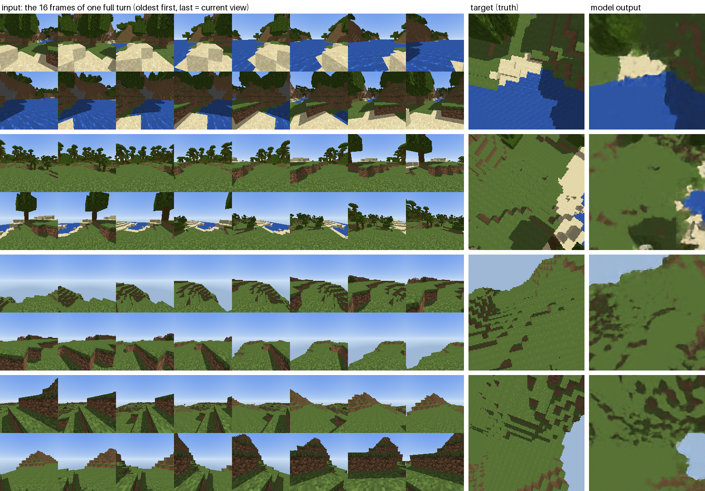
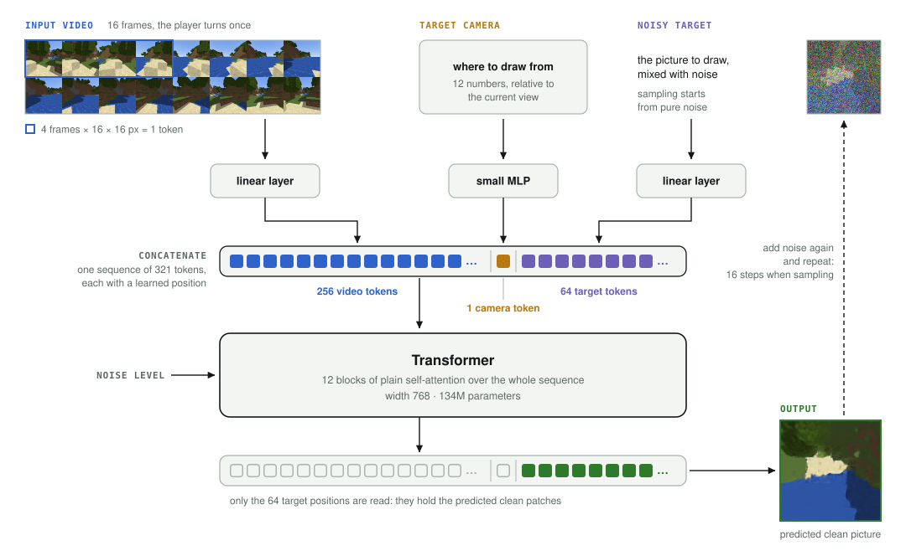

<h1 align="center">Trying to implement Tesla's reality view for Minecraft</h1>

A model that only gets what a Minecraft player saw has to draw the place from straight above. 
A small version of it works.

<a href="https://maxxp0.github.io/minecraft-reality-view/"><b>Read the post →</b></a>

*Four places the model has never seen. Left: its input, the 16 frames of the player turning once on
the spot. Right: the true top-down view and what the model drew.*

## The model

<picture>
  <source media="(prefers-color-scheme: dark)" srcset="img/architecture-dark.svg">
  
</picture>

A pixel-space diffusion transformer in the style of [JiT](https://arxiv.org/abs/2511.13720), with
no encoder and no VAE. Three inputs become tokens and are joined into one sequence, and the
transformer sees all of it at once.

## In short

- **Works:** the player turns once on the spot and the model draws the view from 6 blocks above,
  for places it has never seen. 134M parameters, 128 px, 100 minutes on one H100.
- **Tried first:** predicting Gaussian splats. It was inefficient, because voxel tokens do not
  compress the way image patches do.
- **Still open:** a camera anywhere around a walking player. It needs more compute than this had.

The full story, with how I think Tesla does it, is in the
[post](https://maxxp0.github.io/minecraft-reality-view/).
