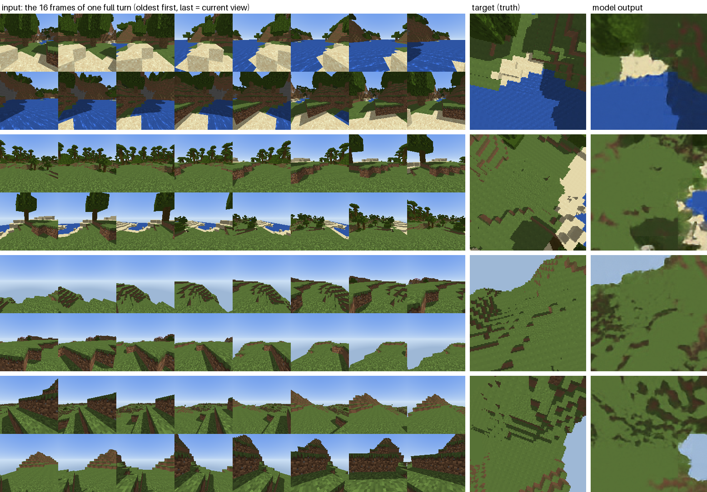
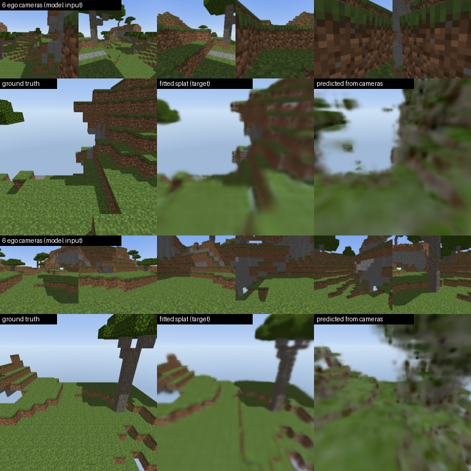
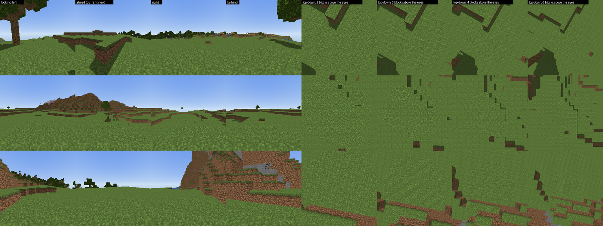
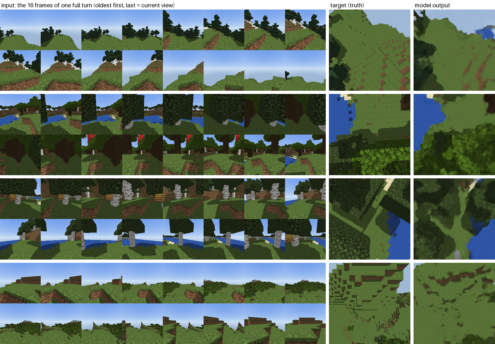
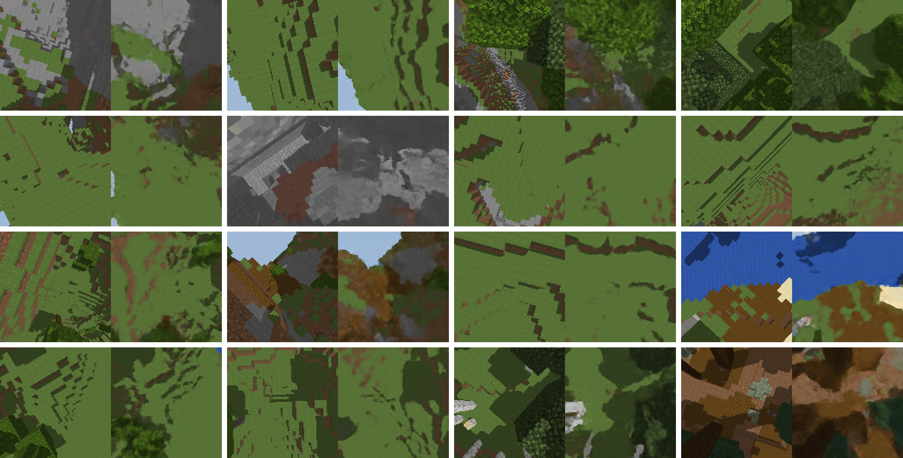

# Trying to implement Tesla's reality view for Minecraft

Tesla's "reality view" shows the scene around the car from a camera that does not exist: a
third-person view, drawn by a generative model from what the car's own cameras saw. After AI Day I
implemented a Tesla-like [occupancy network for Minecraft](https://github.com/MaxxP0/occupancy_model),
so it felt natural to try this one as well. A Minecraft player looks around, and a model that only
gets the player's own frames has to draw the scene from somewhere else.

*Four places the model has never seen. Left: its input, the 16 frames of the player turning once on
the spot. Right: the true top-down view and what the model drew.*

The short version: a small version works. The player turns once, and the model draws the view from
straight above, for places it has never seen, after 100 minutes of training on one H100. The full
version, with a camera anywhere around a walking player, is still open.

## How I think Tesla does it

From [a post by Elon Musk](https://x.com/elonmusk/status/2124458557525397780) and posts by Tesla
staff the rough layout is known:

- a universal vision encoder, trained on a large dataset
- a driving model that predicts the next actions, which does not matter for the live view
- a live-view decoder, described as a mean-flow model with about one billion parameters

Two questions are open.

- **What does the mean-flow model predict?** Either it is told where the camera should be and
  generates that view directly, or it generates a full Gaussian splat that the UI then renders.
- **What data is it trained on?**

## First guess: predict the Gaussians

I started with the second reading: fit Gaussian splats to Minecraft terrain, then train a model
that produces the Gaussians around the player from the player's cameras.

*Top of each block: the six input cameras. Below: ground truth, the fitted splat, and the Gaussians
the model predicted.*

It gets the layout right, but it is inefficient, and the reason is the tokens. Image models can use
large patches because image patches compress extremely well. A block of Gaussians in a voxel grid
does not:

| Token | Values | Dimensions needed for 95% of the variance |
|---|---|---|
| Image patch, 16 × 16 px | 768 | 1.6% |
| Cube of 4 × 4 × 4 Gaussians | 832 | 60% |
| Random noise, for comparison | 832 | 93% |

So the tokens have to stay small, and a volume needs a lot of them. A box only 19 blocks wide
around the player was already 1,152 tokens, where a whole 192 px picture is 144. The volume grows
with every block of range; a picture costs the same however far it sees. On top of that the output
can never be better than the splats it was trained on: the model reached 19.1 dB against a ceiling
of 26.0 dB.

## Where the training data probably comes from

My guess is that Tesla uses Gaussian splats for the targets, not for the output. A splat fitted
offline has hindsight. It is built from the whole drive, including the frames recorded later, so it
can label backwards in time: it already knows what is around the corner the car has not reached
yet. Rendered from a third-person camera, it is the picture the live model should have drawn at
that moment.

I could have done the same. I fitted splats to my own world, and any view of a splat can serve
as a training target. I chose not to, because I would have had to fit a lot of them: a single
256 × 256 block map is about 1.8 million Gaussians, and fitting 11 of its 16 tiles took about two
H100-hours. Minecraft also does not need it. The world can be rendered from any camera directly, so
the targets are exact and free.

## The model

The model is a pixel-space diffusion transformer in the style of JiT
([Back to Basics: Let Denoising Generative Models Denoise](https://arxiv.org/abs/2511.13720)): 16 px patches, no VAE, and the network
predicts the clean picture.

I skipped the encoder. In Tesla's stack the vision encoder is shared with the driving model. Here it
would have no other downstream use, and pure pixel patches are cleaner. The input video is cut into
patches of 4 frames × 16 × 16 px and embedded by one linear layer. Those video tokens, one token
that says where the target camera is, and the noised patches of the target picture form one
sequence, and the rest is plain self-attention.

## Many views: tried, still open

I tried the full version first: a player walking through the world and a target camera at a random
position behind and above. With the compute I had, it did not come together. The model followed
the camera on walks it had memorised, and on new walks it drew a plausible place instead of the
right one.

If you think about it, every possible camera position is something the model has to learn. One
fixed target position cuts that down a lot and trains much faster. So I went for one view first
and left many views for another time, with more compute.

## One view: turn around, draw the map

The player stands still and turns once, 16 frames in total. The target is the view straight down
from 6 blocks above. Every training step uses new places, so the model never sees the same picture
twice.

*Left: four of the 16 input frames (looking left, ahead, right, behind). Right: the view from 2, 3,
4 and 6 blocks above; the target is the last one.*

One thing was needed to make it learn. Trained on the top-down view alone, the model picked up each
place's colours and nothing about its layout. What fixed it was easy targets: three quarters of the
training targets sit on a path from the player's current view up to the top-down camera. At the
start of that path the target is the current view itself, which only needs copying, and from there
the camera rises and tips over step by step.

The result, after 100 minutes on one H100 (134M parameters, 128 px, 3.8 million training samples):

*Four places on maps the model never trained on.*

| Places the model never saw | Maps it trained on | Maps it never trained on |
|---|---|---|
| Model | 23.45 dB | 24.36 dB |
| A flat picture in the right colour | 20.27 dB | 21.96 dB |
| Loss when the input video is turned by 90° | 5.01 dB | 4.02 dB |

The last row is the check that it really reads the layout: the same frames fed in a quarter turn
off have the same colours and objects, and the picture gets clearly worse.

Grass, dirt, stone, water, sand and leaves end up where they are in the truth. The samples are
softer than the real thing and their outlines are rounder. A bit over 40% of the top-down picture
cannot be seen by a player standing on the ground, so that part has to be invented, which is the
reason this is a job for a generative model.

*16 more unseen places; in each pair the truth is on the left.*

The scores were still rising when the run stopped.

## Next

- many views again, with more compute
- one-step generation, as a mean-flow model would do it, in place of the 16-step sampler
- real game frames in place of my own renderer
